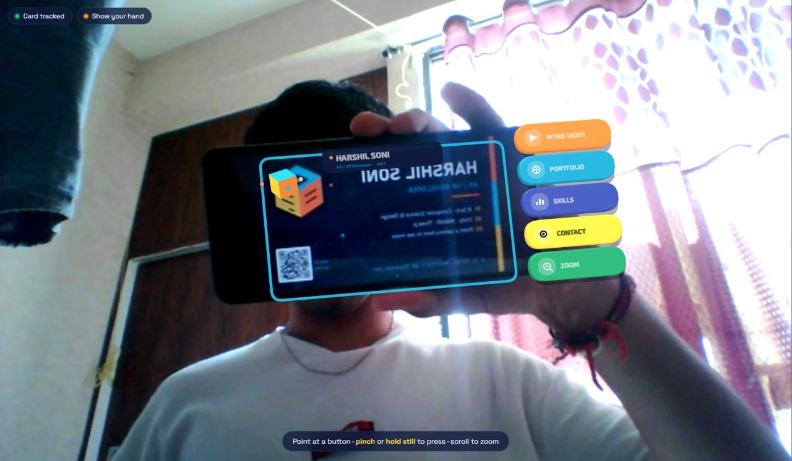
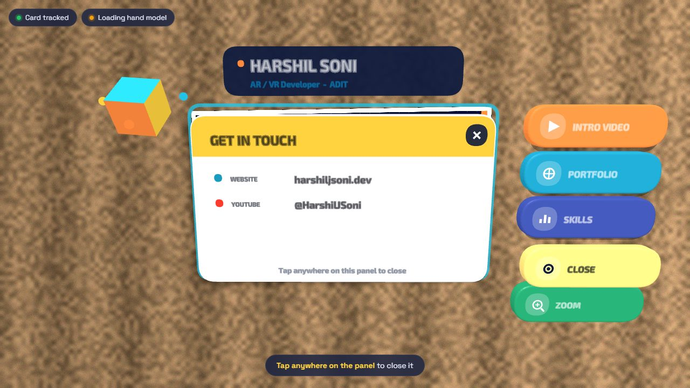
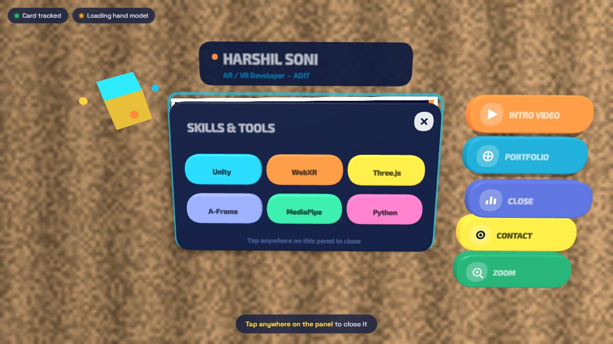
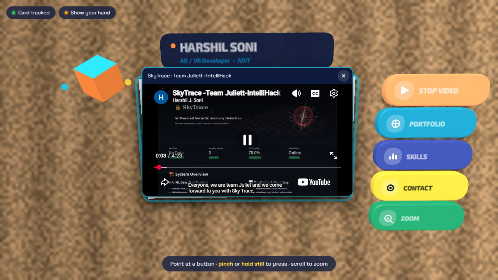
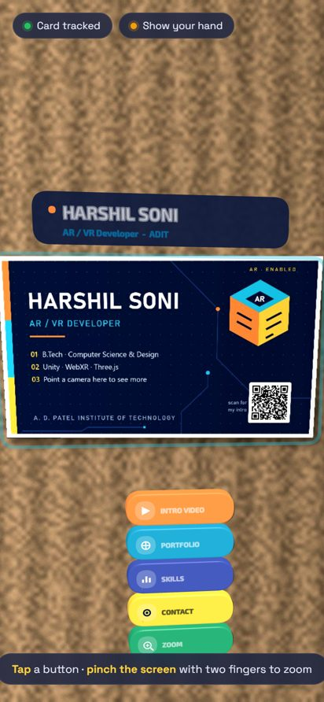
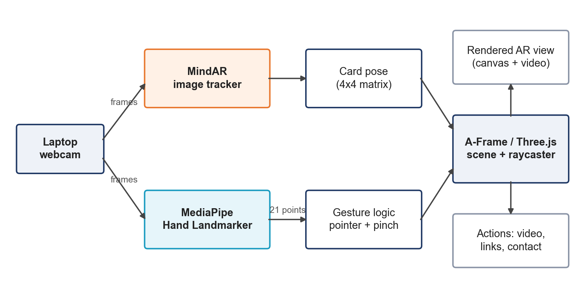

# AR Business Card

A printed business card that comes alive in augmented reality. Hold the card in front of a webcam or a phone camera and
a 3D name banner, a spinning cube and five buttons appear on it. Press the buttons in the air with a pinch (or by
holding your finger still), tap them on a phone, and pinch with two fingers to zoom.

Built as a mini project for the Augmented Reality and Virtual Reality course (202047802) at A. D. Patel Institute of
Technology.



## Download

**Android:** get `AR_Business_Card.apk` from the [latest release](../../releases/latest), open it on your phone, allow
"install unknown apps", then allow the camera. Point the back camera at the card.

**Laptop:** clone the repo and run the web app (below).

## Features
- Natural-feature image tracking of the printed card (no special markers) with MindAR
- Hand tracking with MediaPipe Hand Landmarker: the index fingertip is a pointer
- Press buttons by pinching or by holding still for 0.8 s, with a cooldown so nothing fires twice
- ZOOM starts only on a deliberate pinch or tap, and zoom mode ends by itself after 8 s idle
- INTRO VIDEO, PORTFOLIO, SKILLS, CONTACT and ZOOM buttons, all anchored to the card in 3D
- Finger-spread zoom, mouse-wheel zoom and two-finger zoom on phones
- Mirrored selfie view on laptops, back camera on phones

| Contact panel | Skills panel | Intro video | Phone |
|---|---|---|---|
|  |  |  |  |

## Run the web app
Needs Python 3, Chrome or Edge, a webcam and internet (libraries load from CDNs).

```bash
cd AR_Business_Card
python server.py
```

Open http://localhost:8080, press **Start AR** and show the card. Print `AR_Business_Card/card/AR_Card_Print_A4.pdf`
at 100% scale, or show `AR_Business_Card/assets/card.png` on another screen.

## How it works



The webcam feeds two trackers. MindAR matches FREAK features of the card, fits a homography with RANSAC and refines the
pose, which moves every 3D object attached to the card. MediaPipe returns 21 hand landmarks; the pinch ratio
`|thumb tip - index tip| / palm length` turns them into clicks, and a ray cast from the fingertip picks the button.

| Folder | What is inside |
|---|---|
| `AR_Business_Card/` | The web app (A-Frame scene, gesture logic, UI), the printable card, unit tests |
| `AR_Card_App/` | Capacitor 6 wrapper that builds the Android APK (see its README) |
| `docs/` | Screenshots and the architecture diagram |

## Tests

```bash
cd AR_Business_Card
node --test tests/gesture.test.mjs
```

15 unit tests cover the pinch ratio, hysteresis, hold-to-press, the pinch grace window, cooldown and zoom.

## Built with
[A-Frame](https://aframe.io) 1.5, [MindAR](https://github.com/hiukim/mind-ar-js) 1.2.5,
[MediaPipe Tasks Vision](https://ai.google.dev/edge/mediapipe) 0.10.14, [Capacitor](https://capacitorjs.com) 6.
